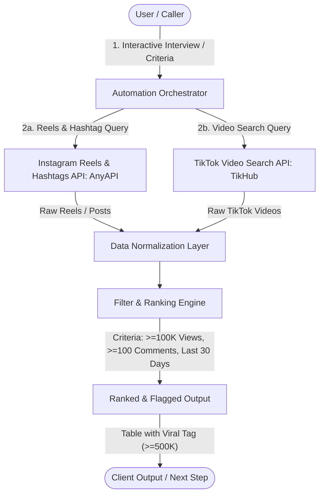
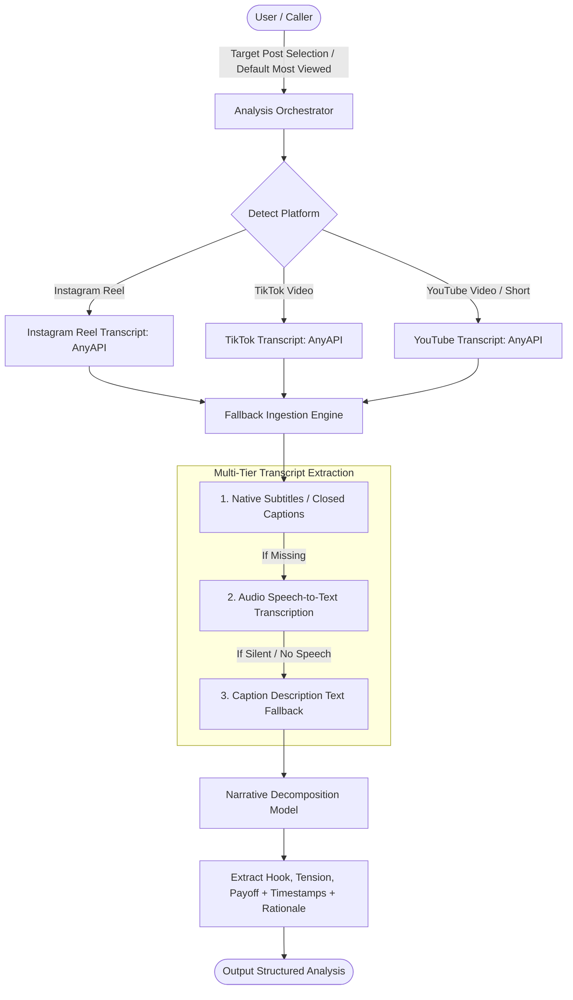
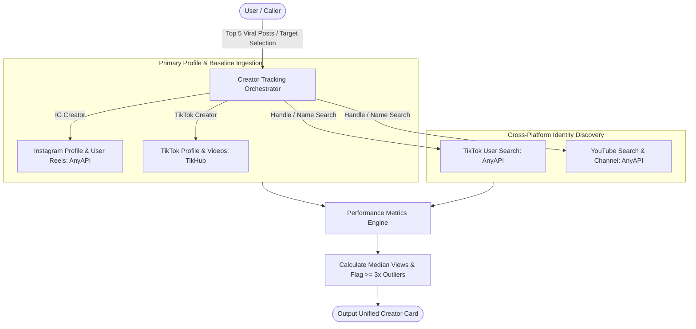
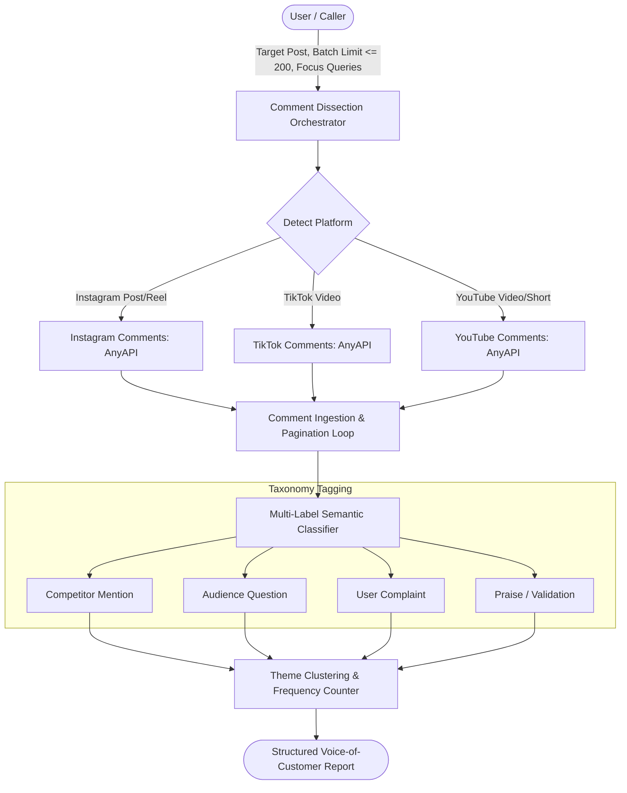
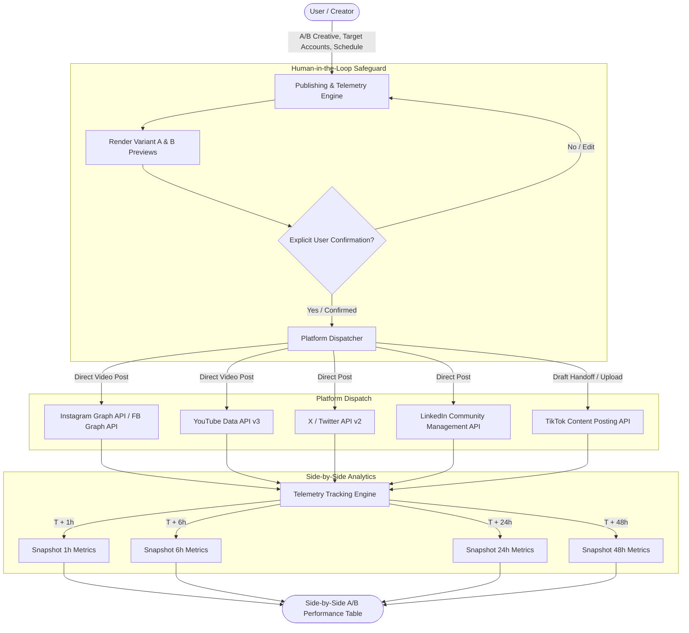

# social-media-automation

An agent skill for Claude Code, Codex and other coding agents. It finds viral short-form posts on Instagram and TikTok, breaks them into hook, tension and payoff, tracks creators for breakout posts, sorts comments into competitor, question, complaint and praise, then posts A/B variants after a human approves the preview.

## Demo

[](https://github.com/SneharupMukherjee/social-media-automation-skill/raw/main/media/demo.mp4)

click the preview for the full video with sound.

## Install

```bash
git clone https://github.com/SneharupMukherjee/social-media-automation-skill ~/.claude/skills/social-media-automation
```

Set `ANYAPI_KEY` (Instagram, YouTube) and `TIKHUB_TOKEN` (TikTok). 

## Files

- `SKILL.md`: the skill the agent reads
- `scripts/find_viral.py`: search helper
- `docs/`: architecture and API details

---

## Social Media Automation — Technical Architecture & Pipeline Specification

## Pipeline Overview
This document specifies the technical architecture, execution flow, agent prompt specifications, and API integration contracts for an end-to-end Social Media Automation system.

The system automates the full lifecycle of content intelligence and distribution across short-form video platforms:
1. **Find**: Discovery and filtering of viral posts.
2. **Decode**: Structural deconstruction of narrative hooks, tension, and payoffs.
3. **Track**: Creator baseline benchmarking and outlier detection.
4. **Listen**: Audience sentiment, competitor mentions, and question extraction from comments.
5. **Post**: Automated publishing, in-app handoff drafts, and telemetry benchmarking.

---

## Step 01: Find — Search Viral Posts

## Overview
Discovers top-performing short-form video content across Instagram and TikTok using search and hashtag discovery endpoints. Candidates are normalized, filtered against minimum engagement thresholds, and ranked by views.

---

## 1. Architecture & Execution Flow



---

## 2. Prompt Specification

```text
Interview me first, one question at a time: my topic, which platforms (default: Instagram and TikTok) and any filters (default: 100K+ views, 100+ comments, last 30 days). 

Then search each platform using the respective provider APIs:
- For Instagram: Query Reels Search and Hashtag Posts via AnyAPI.
- For TikTok: Query Video Search via TikHub.

Page through results until you have enough candidates, and apply my filters yourself (search results come back ranked by relevance, not by date). 

Return a table: link, creator, views, likes, comments, date, and the first line of the caption, sorted by views, with anything over 500K views marked viral.
```

---

## 3. API Integration Contracts

### 3.1. Instagram (AnyAPI)

#### A. Reels Search
- **Endpoint**: `/instagram/reels/search`
- **Method**: `GET` / `POST`
- **Parameters**:
  - `query` (*string*, required): Topic keywords (e.g., `"noise cancelling headphones"`).
  - `cursor` / `page` (*string*, optional): Pagination token.
- **Extracted Fields**:
  - `id`: Media identifier.
  - `code`: Post shortcode (`https://www.instagram.com/reel/{code}/`).
  - `user.username`: Creator account handle.
  - `play_count` / `view_count`: Total reel views.
  - `like_count`: Total likes.
  - `comment_count`: Total comments.
  - `taken_at`: Epoch timestamp of creation.
  - `caption.text`: Caption string.

#### B. Hashtag Posts
- **Endpoint**: `/instagram/hashtag/posts`
- **Method**: `GET`
- **Parameters**:
  - `tag_name` (*string*, required): Topic hashtag without symbol.
  - `cursor` (*string*, optional): Pagination cursor.
- **Extracted Fields**:
  - `shortcode`: URL shortcode.
  - `owner.username`: Creator handle.
  - `video_view_count`: Total views.
  - `edge_media_preview_like.count`: Like count.
  - `edge_media_to_comment.count`: Comment count.
  - `taken_at_timestamp`: Publication date.
  - `edge_media_to_caption.edges[0].node.text`: Caption string.

---

### 3.2. TikTok (TikHub)

#### Video Search
- **Endpoint**: `/tiktok/api/v1/search/item`
- **Method**: `GET` / `POST`
- **Parameters**:
  - `keyword` (*string*, required): Search term.
  - `cursor` / `offset` (*integer*, optional): Pagination offset.
  - `count` (*integer*, optional, default: 20-30): Batch limit.
- **Extracted Fields**:
  - `aweme_id`: Video ID (`https://www.tiktok.com/@{author.unique_id}/video/{aweme_id}`).
  - `author.unique_id`: Creator username.
  - `statistics.play_count`: Total plays.
  - `statistics.digg_count`: Total likes.
  - `statistics.comment_count`: Total comments.
  - `create_time`: Epoch timestamp.
  - `desc`: Video description text.

---

## 4. Normalization Schema & Filtering Rules

### 4.1. Unified Record Format
```json
{
  "id": "post_unique_id",
  "platform": "instagram" | "tiktok",
  "link": "https://...",
  "creator": "@handle",
  "views": 620000,
  "likes": 28400,
  "comments": 1250,
  "published_at": "2026-10-28T10:15:00Z",
  "caption_first_line": "Best budget wireless headphones under $100...",
  "is_viral": true
}
```

### 4.2. Filter Criteria
- `views >= 100,000`
- `comments >= 100`
- `published_at >= (now - 30 days)`
- `is_viral = true` when `views >= 500,000`
- Sorted descending by `views`.

---

## 5. Sample Output Format

| Link | Creator | Views | Likes | Comments | Date | Caption (First Line) | Viral Status |
| :--- | :--- | :--- | :--- | :--- | :--- | :--- | :--- |
| [instagram.com/reel/Cx...](https://instagram.com) | `@audiophile_guru` | 840,000 | 45,200 | 1,820 | 2026-10-20 | The AirPods Max 2 just dropped... | 🟢 Viral |
| [tiktok.com/@tech.../video/...](https://tiktok.com) | `@techbite` | 512,000 | 31,000 | 940 | 2026-10-24 | Are Sony XM5s still worth it in 2026? | 🟢 Viral |
| [instagram.com/reel/Cy...](https://instagram.com) | `@soundcheck` | 210,000 | 14,300 | 340 | 2026-11-01 | Top 3 ANC headphones under $150 | - |

---

## Step 02: Decode — Decode Viral Post Structure

## Overview
Extracts the content transcript from high-performing videos across Instagram, TikTok, and YouTube via dedicated transcript endpoints, then deconstructs its narrative arc into **Hook**, **Tension**, and **Payoff** components with exact timestamps and operational rationales.

---

## 1. Architecture & Execution Flow



---

## 2. Prompt Specification

```text
Ask me which post to decode (default: the most-viewed one). 

Retrieve its transcript using the appropriate provider endpoint:
- For Instagram Reels: Query Reel Transcript via AnyAPI.
- For TikTok: Query TikTok Transcript via AnyAPI.
- For YouTube Shorts / Videos: Query YouTube Transcript via AnyAPI.

Use captions first, audio transcription if there are none, and the post caption if the video has no speech. 

Split it into hook, tension and payoff, with timestamps where the transcript carries them, and say in one line why each part works.
```

---

## 3. API Integration Contracts

### 3.1. Instagram Reel Transcript (AnyAPI)
- **Endpoint**: `/instagram/reel/transcript`
- **Method**: `GET`
- **Parameters**: `url` or `code` (*string*, required).
- **Extracted Fields**:
  - `has_captions`: Boolean flag.
  - `subtitles[]`: Array of `{ "start_time": float, "end_time": float, "text": string }`.
  - `raw_caption`: Caption text fallback.

### 3.2. TikTok Transcript (AnyAPI)
- **Endpoint**: `/tiktok/video/transcript`
- **Method**: `GET`
- **Parameters**: `url` or `video_id` (*string*, required).
- **Extracted Fields**:
  - `has_subtitles`: Boolean flag.
  - `transcript[]`: Array of `{ "start": float, "end": float, "text": string }`.
  - `description`: Video description fallback.

### 3.3. YouTube Transcript (AnyAPI)
- **Endpoint**: `/youtube/video/transcript`
- **Method**: `GET`
- **Parameters**: `url` or `video_id` (*string*, required), `lang` (*string*, optional).
- **Extracted Fields**:
  - `transcript[]`: Array of `{ "start": float, "duration": float, "text": string }`.

---

## 4. Extraction Fallback Priority Matrix

| Priority Tier | Source Type | Condition / Trigger | Timestamp Fidelity |
| :---: | :--- | :--- | :--- |
| **Tier 1 (Primary)** | Native Platform Subtitles / CC | Available in API response payload | High precision (Millisecond / Second offsets) |
| **Tier 2 (Secondary)** | Audio Speech-to-Text | Native captions missing/disabled | Word / sentence-level timestamps |
| **Tier 3 (Fallback)** | Text Caption / Description | Video contains background audio only, no vocal speech | Global (Full video scope) |

---

## 5. Narrative Deconstruction Schema & Output

```json
{
  "post_link": "https://www.instagram.com/reel/Cx...",
  "creator": "@audiophile_guru",
  "structure": {
    "hook": {
      "timestamp": "0:00 - 0:03",
      "text": "Stop buying the wrong noise cancelling headphones.",
      "why_it_works": "Creates immediate fear of making an expensive mistake and stops the scroll."
    },
    "tension": {
      "timestamp": "0:03 - 0:18",
      "text": "Everyone recommends the $400 pair, but after 3 months the headband hinge snaps...",
      "why_it_works": "Subverts standard influencer hype with authentic user pain points."
    },
    "payoff": {
      "timestamp": "0:18 - 0:32",
      "text": "Get this $120 alternative instead: same 45dB ANC rating and LDAC codec support.",
      "why_it_works": "Delivers a practical, budget-conscious recommendation that resolves the stated friction."
    }
  }
}
```

---

## Step 03: Track — Track the Creators

## Overview
Evaluates the account baseline of creators behind viral posts (followers, posts, biography, external links), computes view performance benchmarks, identifies breakout posts that beat their historical median by 3x or more, and resolves matching creator profiles across Instagram, TikTok, and YouTube.

---

## 1. Architecture & Execution Flow



---

## 2. Prompt Specification

```text
Ask me which posts to follow up (default: the top 5 viral ones). 

For each creator, query the respective provider endpoints:
- For Instagram: Pull profile (followers, posts, bio, links) and recent user reels with views via AnyAPI.
- For TikTok: Pull profile and recent posts via TikHub.
- For Cross-Platform Discovery: Search for matching handles/names across other platforms using AnyAPI (TikTok User Search, YouTube Search, and YouTube Channel endpoints).

Calculate the creator's median view count across their recent posts, and flag the posts that beat their median by 3x or more (breakout posts).

Return one card per creator including their bio, followers, cross-platform links, median views, and outlier posts.
```

---

## 3. API Integration Contracts

### 3.1. Instagram (AnyAPI)
- **Profile Endpoint**: `GET /instagram/user/profile` (`username` required).
  - Extract: `user.follower_count`, `user.media_count`, `user.biography`, `user.external_url`, `user.is_verified`.
- **User Reels Endpoint**: `GET /instagram/user/reels` (`user_id` or `username`, `count` required).
  - Extract: `items[].code`, `items[].play_count`, `items[].like_count`, `items[].comment_count`, `items[].taken_at`.

### 3.2. TikTok (TikHub & AnyAPI)
- **Profile (TikHub)**: `GET /tiktok/api/v1/user/profile` (`unique_id` required).
  - Extract: `user.follower_count`, `user.video_count`, `user.signature`, `user.bio_url`, `recent_videos[].statistics.play_count`.
- **User Search (AnyAPI)**: `GET /tiktok/user/search` (`keyword` required).
  - Extract: `user_list[].unique_id`, `user_list[].follower_count`.

### 3.3. YouTube (AnyAPI)
- **Channel Search**: `GET /youtube/search` (`query` required, `type="channel"`).
  - Extract: `items[].channel_id`, `items[].title`.
- **Channel Details**: `GET /youtube/channel/details` (`channel_id` required).
  - Extract: `statistics.subscriberCount`, `statistics.videoCount`, `snippet.description`, `snippet.customUrl`.

---

## 4. Breakout Analysis & Outlier Algorithm

1. **Sample Size**: Retrieve view counts for the last $N$ posts (default: $N = 20$).
2. **Median Calculation**:
   $$\text{Median Views} = \mathrm{median}(\{V_1, V_2, \dots, V_N\})$$
3. **Breakout Threshold**:
   $$\text{Breakout Multiplier} \ge 3.0 \times \text{Median Views}$$
4. **Outlier Ratio**:
   $$\text{Outlier Ratio} = \frac{\text{Post Views}}{\text{Median Views}}$$

---

## 5. Creator Profile Card Output

```markdown
┌────────────────────────────────────────────────────────────────────────┐
│  @audiophile_guru (Audiophile Guru)                                    │
│  "Honest tech & audio gear teardowns. No sponsored BS."                │
├────────────────────────────────────────────────────────────────────────┤
│  • Instagram: 142K followers | Median Views: 38K                       │
│  • TikTok:    98.5K followers | Median Views: 25K                      │
│  • YouTube:   45K subscribers                                          │
│  • Linktree:  https://linktr.ee/audiophileguru                         │
├────────────────────────────────────────────────────────────────────────┤
│  ⚡ Breakout Posts (>= 3x Median):                                     │
│  1. [AirPods Max 2 Flaws](https://instagram.com/reel/Cx...)            │
│     840K views (22.1x over 38K median)                                │
│  2. [Don't Buy Sony XM5 in 2026](https://tiktok.com/@...)              │
│     190K views (7.6x over 25K median)                                  │
└────────────────────────────────────────────────────────────────────────┘
```

---

## Step 04: Listen — Dissect the Comments

## Overview
Ingests raw audience comments from high-performing videos across Instagram, TikTok, and YouTube via comment endpoints. Comments are processed through a multi-label classification engine that tags intent (**Competitor**, **Question**, **Complaint**, **Praise**), clusters key sub-themes, and quotes verbatim feedback.

---

## 1. Architecture & Execution Flow



---

## 2. Prompt Specification

```text
Ask me which post's comments to read (default: the one we decoded), how many (default: up to 200) and whether I care about anything specific, like a competitor or a feature. 

Pull the comments using the respective provider endpoint:
- For Instagram: Query Comments endpoint via AnyAPI.
- For TikTok: Query Comments endpoint via AnyAPI.
- For YouTube: Query Comments endpoint via AnyAPI.

Page through the comments until the requested limit is reached. 

Tag each comment as competitor, question, complaint, or praise (one comment can carry more than one tag). Count each tag, list the top 3 themes under each, and quote 2 real comments per tag.
```

---

## 3. API Integration Contracts

### 3.1. Instagram Comments (AnyAPI)
- **Endpoint**: `GET /instagram/media/comments`
- **Parameters**: `code` or `media_id` (*string*, required), `cursor` (*string*, optional).
- **Extracted Fields**: `comments[].id`, `comments[].text`, `comments[].like_count`, `comments[].user.username`, `comments[].created_at`.

### 3.2. TikTok Comments (AnyAPI)
- **Endpoint**: `GET /tiktok/video/comments`
- **Parameters**: `video_id` (*string*, required), `cursor` (*integer*, optional), `count` (*integer*, optional, default: 50).
- **Extracted Fields**: `comments[].cid`, `comments[].text`, `comments[].digg_count`, `comments[].user.unique_id`, `comments[].create_time`.

### 3.3. YouTube Comments (AnyAPI)
- **Endpoint**: `GET /youtube/video/comments`
- **Parameters**: `video_id` (*string*, required), `pageToken` (*string*, optional), `maxResults` (*integer*, optional, default: 50).
- **Extracted Fields**: `items[].snippet.topLevelComment.snippet.textOriginal`, `items[].snippet.topLevelComment.snippet.likeCount`, `items[].snippet.topLevelComment.snippet.authorDisplayName`.

---

## 4. Multi-Label Classification Taxonomy

| Tag | Classification Criteria | Keyword / Pattern Triggers |
| :--- | :--- | :--- |
| **Competitor** | References other brands, rival models, or alternatives. | `"Bose"`, `"Sony"`, `"AirPods"`, `"Sennheiser"`, `"Soundcore"`, `"better than X"` |
| **Question** | Seeks clarification, advice, specs, or compatibility. | `"How is..."`, `"Does it support..."`, `"Where to buy?"`, `"Is it worth..."`, `?` |
| **Complaint** | Mentions hardware defects, pricing issues, discomfort, bad software. | `"broke"`, `"uncomfortable"`, `"overpriced"`, `"latency"`, `"too heavy"`, `"disappointed"` |
| **Praise** | Positive affirmation, purchase validation, content appreciation. | `"love these"`, `"best purchase"`, `"great video"`, `"underrated"`, `"w"`, `"10/10"` |

---

## 5. Output Schema

```json
{
  "total_comments_analyzed": 200,
  "tag_counts": {
    "competitor": 42,
    "question": 68,
    "complaint": 31,
    "praise": 85
  },
  "tag_analysis": {
    "competitor": {
      "top_themes": [
        "Comparison against Sony WH-1000XM5",
        "Bose QuietComfort Ultra comfort comparison",
        "AirPods Max value proposition"
      ],
      "quotes": [
        "How do these compare to the XM5s for gym use?",
        "Honestly Bose QC45 still has way better ANC than this pair."
      ]
    },
    "question": {
      "top_themes": [
        "Multipoint Bluetooth connectivity",
        "Microphone quality in windy environments",
        "Glasses compatibility and ear clamp force"
      ],
      "quotes": [
        "Do these hurt your ears if you wear thick glasses?",
        "Can you connect both iPhone and MacBook at the same time seamlessly?"
      ]
    },
    "complaint": {
      "top_themes": [
        "Headband snapping after 6 months",
        "Laggy companion app on Android",
        "High retail price without included hard case"
      ],
      "quotes": [
        "Sound is good but the headband cracked on month 4. Support refused warranty.",
        "The app is so slow on Android it takes 30 seconds just to change EQ."
      ]
    },
    "praise": {
      "top_themes": [
        "Transparent, unbiased review style",
        "ANC performance on flights",
        "Battery life exceeding claims"
      ],
      "quotes": [
        "Finally a creator who doesn't sugarcoat the bad hinge design!",
        "Got 40 hours with ANC on during my international trip, absolutely insane."
      ]
    }
  }
}
```

---

## Step 05: Post — Auto Post & Multi-Platform Performance Tracking

## Overview
Automates scheduling, preview verification, A/B variant publishing, and telemetry tracking across connected user accounts (**Instagram, TikTok, YouTube, Facebook, LinkedIn, X/Twitter**) using platform developer APIs.

Where direct publishing is supported, posts are published automatically via API. Where platform constraints require user review (e.g., TikTok Creator Inbox draft delivery), draft artifacts are uploaded to the platform inbox with a mobile handoff notification. Telemetry is tracked at **1h, 6h, 24h, and 48h**.

---

## 1. Architecture & Execution Flow



---

## 2. Prompt Specification

```text
Ask me which of my connected accounts to post to, when, and for the two versions to test, A and B, with a public link to any image or video. 

Show me both versions before anything goes out, and post only after I explicitly say yes. 

Publish using the respective platform APIs where allowed:
- Direct publish to Instagram Reels and Facebook via Meta Graph API.
- Direct publish to YouTube Shorts via YouTube Data API v3.
- Direct publish to LinkedIn and X via their respective developer APIs.
- For TikTok: Where direct immediate publishing is restricted or requires inbox review, push the video as a draft to my TikTok Inbox via the TikTok Content Posting API and tell me to finalize it in the app.

Then read back views, likes, comments, and shares from my accounts at 1h, 6h, 24h, and 48h, presented in a side-by-side A/B comparison table.
```

---

## 3. API Integration Contracts

### 3.1. Instagram & Facebook (Meta Graph API)
- **Instagram Reels Endpoint**: `POST /{ig_user_id}/media` $\rightarrow$ `POST /{ig_user_id}/media_publish`
- **Parameters**: `media_type: "REELS"`, `video_url: "<URL>"`, `caption: "..."`.
- **Insights Endpoint**: `GET /{media_id}/insights?metric=plays,impressions,likes,comments,saved,shares`.

### 3.2. TikTok (TikTok Content Posting API)
- **Direct Video Upload Endpoint**: `POST /v2/post/publish/video/init/`
- **Draft / Creator Inbox Mode**:
  - `post_info.privacy_level`: `"SELF_ONLY"` or destination set to Creator Inbox container.
  - Handoff note: *"Variant uploaded to your TikTok inbox. Open TikTok to select sound and tap Post."*
- **Telemetry Endpoint**: `POST /v2/video/query/` (`view_count`, `like_count`, `comment_count`, `share_count`).

### 3.3. YouTube Shorts (YouTube Data API v3)
- **Upload Endpoint**: `POST /upload/youtube/v3/videos?uploadType=resumable&part=snippet,status`
- **Parameters**: `snippet.title`, `snippet.description`, `status.privacyStatus: "public"`.
- **Telemetry Endpoint**: `GET /youtube/v3/videos?id={video_id}&part=statistics` (`viewCount`, `likeCount`, `commentCount`).

### 3.4. X / Twitter (X API v2)
- **Media Upload**: `POST upload.twitter.com/1.1/media/upload.json`
- **Tweet Creation**: `POST /2/tweets` (`{"text": "...", "media": {"media_ids": ["..."]}}`).
- **Telemetry Endpoint**: `GET /2/tweets/{tweet_id}?tweet.fields=public_metrics,non_public_metrics`.

### 3.5. LinkedIn (Community Management API)
- **Media Ingestion**: `POST /rest/images` or `/rest/videos`
- **Post Creation**: `POST /rest/posts`
- **Telemetry Endpoint**: `GET /rest/organizationalEntityShareStatistics`.

---

## 4. Telemetry Tracking Intervals & Report Format

Snapshots are automatically recorded at **$T+1\text{h}$**, **$T+6\text{h}$**, **$T+24\text{h}$**, and **$T+48\text{h}$**.

### Side-by-Side Performance Comparison (Sample 24h Snapshot)

| Metric | Variant A ("Stop buying...") | Variant B ("We tested 50...") | Delta (B vs A) | Winner |
| :--- | :--- | :--- | :--- | :--- |
| **Platform** | Instagram Reel | Instagram Reel | — | — |
| **Views / Plays** | 48,200 | 82,600 | +71.3% | 🟢 **Variant B** |
| **Likes** | 2,150 | 4,920 | +128.8% | 🟢 **Variant B** |
| **Comments** | 142 | 310 | +118.3% | 🟢 **Variant B** |
| **Shares** | 89 | 430 | +383.1% | 🟢 **Variant B** |
| **Save / Bookmark Rate** | 1.8% | 4.6% | +155.5% | 🟢 **Variant B** |
| **Retention @ 3s** | 62% | 78% | +25.8% | 🟢 **Variant B** |
